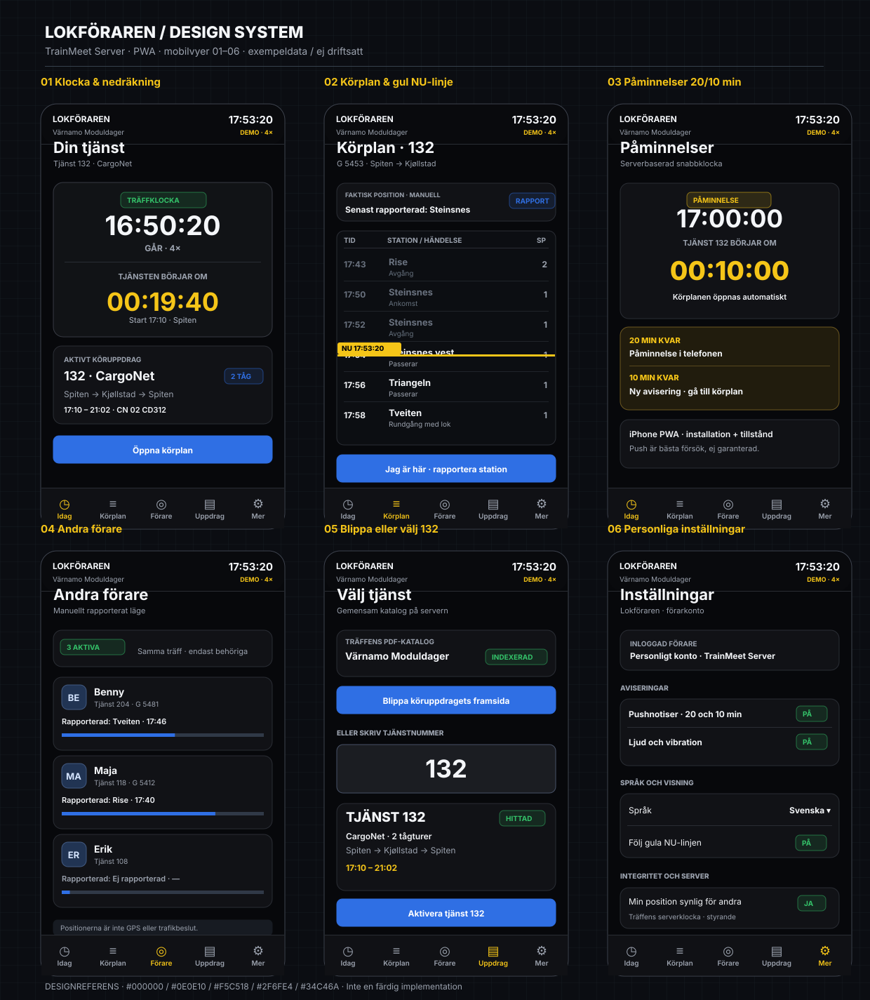
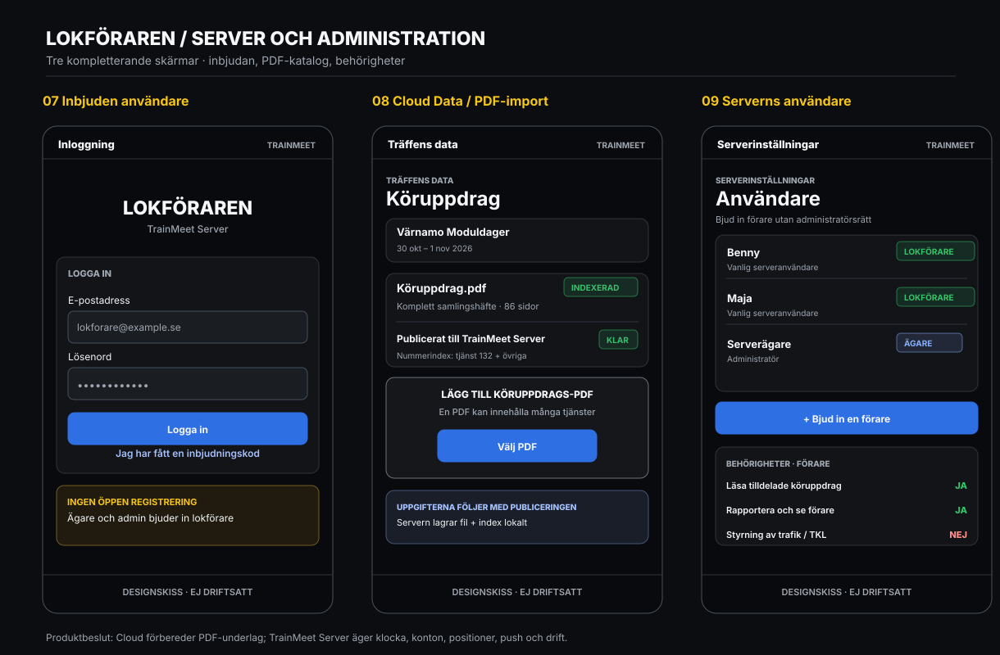
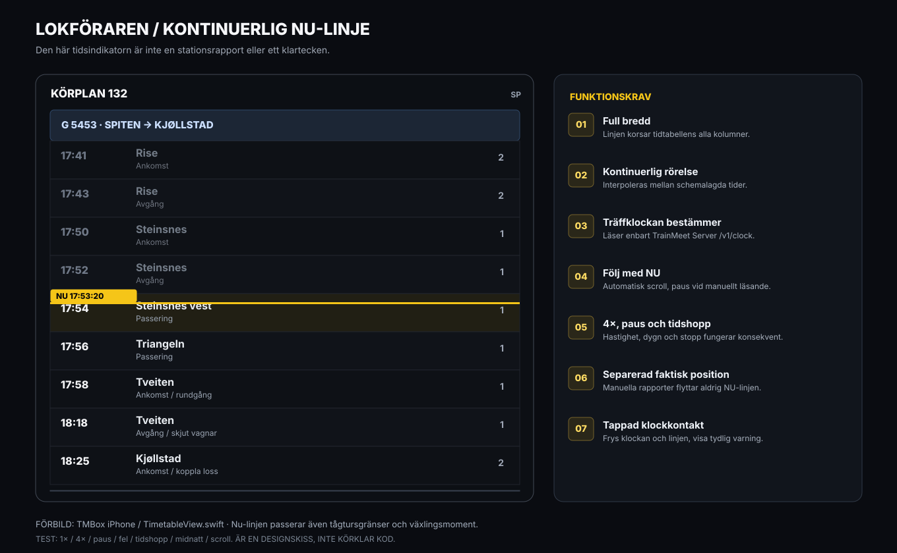
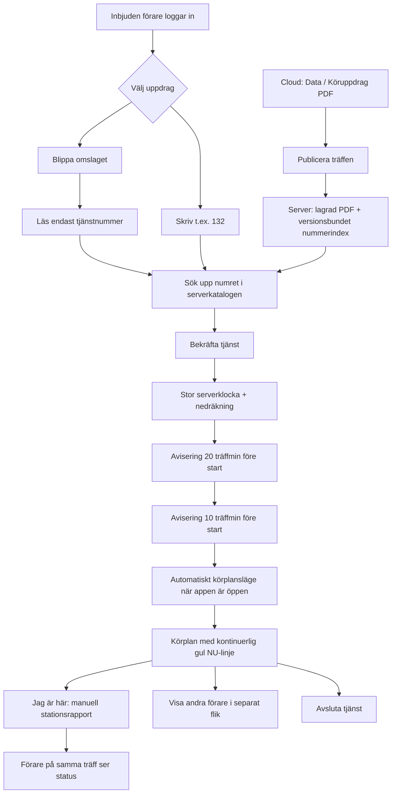

# Lokföraren – design och implementationsunderlag

**Status:** Designreferens, **inte** en driftsatt funktion. Huvudissue: [#225](https://github.com/beahead-ab/trainmeet-server/issues/225). Fördjupat NU-linjeärende: [#226](https://github.com/beahead-ab/trainmeet-server/issues/226).

## Skärmritningar

### Mobil PWA: förarflödet


### Inloggning, Cloud Data och användarbehörigheter


### Fördjupning: NU-linjen


**Viktigt:** Skisserna illustrerar form och beteende. Tider, användarnamn, registrerade stationer, antal PDF-sidor och katalogstatus är exempelvärden – inga liveuppgifter.

## Principer och beslut

- Namn: **Lokföraren**.
- Plattform: installerbar PWA, `/lokforaren`, servad och autentiserad av **TrainMeet Server**. Ingen Lovable-koppling.
- Design: svart som TMBox iPhone. Inte en modifiering av fysisk TMBox, ingen 4x4-knappsats.
- Träffklocka: **servern är enda källan**. Ingen matchning mot serverns tidtabeller eller trafikgraf.
- Underlag: **TrainMeet Cloud → träffens Data → Köruppdrag (PDF)**. Vid publicering görs filen tillgänglig, indexerad och lagrad på servern för lokal användning. Förarna återanvänder katalogen.
- Ägare bjuder in vanliga serveranvändare med rättigheten Lokföraren; inga öppna konton eller adminbehörighet krävs för föraren.
- Förarrapporterade stationer är social status och får **aldrig** ändra TrainMeet Servers auktoritativa trafikläge.

## Navigationskarta

| Vy | Standardfunktion | Innehåll / handling |
| --- | --- | --- |
| **Idag** | Förstart | Serverklocka, faktorklocka, 20/10-minutersnedräkning, vald tjänst, nästa moment |
| **Körplan** | Aktiv tjänst | Full kronologisk tjänst med rörlig NU-linje, stationer, spår, växling, rapportera station, original-PDF |
| **Förare** | Socialt läge | Kollegor med tjänst, tåg och senast manuellt rapporterade station, detaljvy i läsläge |
| **Uppdrag** | Välj/byta tjänst | Sök på tjänstnummer, mobilkamera för omslag, kontrollera och aktivera |
| **Mer** | Eget konto | Språk, push, synlighet, klock-/anslutningsstatus, PWA-installation |
| **Logga in** | Endast inbjudna | Befintlig serverinbjudan, e-post, lösenord, återställning |
| **Cloud Data** | Admin | Uppladdning/versionering av hela PDF-häftet, indexering och publicering |
| **Server Användare** | Ägare | Bjud in användare, rättigheten `can_use_driver`, återkalla, granska |

## Användarflöde



## Visuella tokens

| Token | Värde | Tillämpning |
| --- | --- | --- |
| `background` | `#000000` | Hela appen |
| `card` | `#0E0E10` | Paneler |
| `border` | `#232326` | Kortkonturer och avdelare |
| `text` | `#FAFAFA` | Primär text |
| `muted` | `#8E8E93` | Sekundär text |
| `now` | `#F5C518` | Obruten NU-linje, nedräkning, brådskande instruktioner |
| `action` | `#2F6FE4` | Primär interaktion |
| `ok` | `#34C46A` | Verifierat, online, godkänt |
| `danger` | `#D9342B` | Fel (inte bara färg) |

Typografi: SF Pro / systemtypsnitt, monospaced/tabular-numeric för alla tidtal. Kort radie 12 px, knappar 8 px, tydlig kontrast, safe areas för iPhone, minimum 44 px på touchmål i färdig UI. Konsekventa ikoner och synliga textetiketter. Responsiv mobilporträtt/-landskap, tablet, desktop.

## Viktiga komponenter

### 1. ServerClock
- Tydlig träfftid i `HH:MM:SS`, hastighet `×4`, status `GÅR`/`PAUSAD`, aktiv träff/trafikdag, uppkopplingsstatus.
- Poll `GET /v1/clock` ca 2–5 sekunder. Interpolera via monotont tidsmått mellan svar, hantera RTT, 24/48h, hopp, paus och källa.
- Stale klockdata: **frys** klocka, nedräkning och NU-linje; visa varning. Aldrig väggklockefallback.

### 2. DutyCountdown
- Vid vald tjänst visas `Start om 00:19:40` och klockan. Räknar till **tjänstestart** (exempel 17:10), inte första tågets avgång (17:30).
- Exakt vid 20 och 10 återstående **träffminuter**: en påminnelse per epok/träff/tjänst/tröskel; klockhopp bakåt får inte skapa spambeteende.
- Vid 10 minuter: körplanen blir aktiv i **öppen** PWA. En stängd PWA kan inte tvingas byta skärm; pushklick öppnar rätt djuplänk.
- Web Push kräver HTTPS, installation på hemskärmen i iOS, explicita notisrättigheter och Service Worker + VAPID. Säker synk till klockfaktor och paus; pushleverans garanteras inte.

### 3. DutyTimeline och NowLine
- En gemensam tidsaxel för alla tågturer och förberedelser. En obruten **fullbredd horisontell linje**.
- Placera linjen mellan schematider med kontinuerlig interpolation; inget stegvis hopp mellan rader. Synlig NU-tid ansluter till linjen.
- Håll linjen cirka 1/3 ned via autofölj. Avbryt automatisk scroll när användaren interagerar, återgå efter 4 sekunder eller knappen **Till NU**.
- 1×, 4×, paus, tidshopp och midnatt. Skilj tidsepoch/trafikdag från 24h-display.
- Tidtabell visar planerade händelser, **inte** position enligt aktuell tid. Oberoende manuell position separat.
- Visa käll-PDF/sidnummer och ett strukturerat instruktion-/växlingskort. Okända fakta markeras som okända och behöver granskas.

### 4. DutyPicker
- När gemensam katalog finns på servern: sök efter nummer, eller skanna förstasidan för att läsa endast tjänstnummer.
- Bekräftelseruta `Tjänst 132 – Aktivera?` med träff, datum, lok, start och rutt.
- Ingen egen fullständig uppladdning i normalfallet; eventuell kompletteringsimport endast för behörig admin.
- Hantera ej hittad, dubblett, osäkert OCR-resultat, två samtidiga enheter, byte av träff och redan aktiv tjänst.

### 5. DriverPresence
- `Jag är här` öppnar vald station (föreslå närmaste planerade, men **rapportera inte automatiskt**), spår frivilligt. `På väg` kan rapporteras explicit.
- Spara med träff, konto, tjänst, tågtur och serverträfftid. Tillåt rättelse, visa vem som rapporterat och hur gammal uppgiften är.
- `Andra förare` begränsas till samma träff/behörighet/synlighetsval; läsvy för kollegas uppdrag.
- Ingen GPS-claim, inget automatiskt trafikmyndighetsbeslut, inga TMBox- eller TKL-kommandon.

### 6. Language
- Fem språk: `sv`, `da`, `nb`, `en`, `de` för UI och analyserade instruktioner.
- Källans ortnamn, tågnummer, vagns-ID, spårnummer behålls ordagrant. AI lagrar neutralt strukturerat ursprung; översättning är presentation, aldrig ny faktakälla.

## Lagring och API-indelning (föreslaget kontrakt, inte befintliga endpoints)

```text
Cloud:
 POST   /api/meets/{meet_id}/duty-sources
 GET    /api/meets/{meet_id}/duty-sources
 Publish -> versionerat asset-manifest för köruppdrag

TrainMeet Server:
 GET    /v1/clock                          (finns redan)
 GET    /v1/driver/catalog                 (nytt)
 GET    /v1/driver/duties?q=132            (nytt)
 GET    /v1/driver/duties/{id}             (nytt)
 GET    /v1/driver/duties/{id}/source      (nytt, auth)
 POST   /v1/driver/cover/identify          (nytt, auth)
 POST   /v1/driver/active                  (nytt, auth)
 PATCH  /v1/driver/active                  (nytt, auth)
 POST   /v1/driver/position                (nytt, auth)
 GET    /v1/driver/presence                (nytt, auth)
 POST   /v1/driver/push-subscriptions      (nytt, auth)
 DELETE /v1/driver/push-subscriptions/{id} (nytt, auth)
```

Skapa separat katalog/DB-modul: `duty_documents`, `duty_index`, `duty_runs`, `driver_activations`, `driver_position_events`, `driver_push_subscriptions`, `driver_notification_receipts` och användarrättighet. Nytt server-API måste skyddas server-side; tjänster måste vara begränsade till aktiv träff och åtkomliga även utan Cloud-anslutning när katalogen väl synkats. Stora PDF-resurser överförs som checksummeverifierade tillgångar, inte i stora öppna JSON-payloads.

## Tomma-, fel- och säkerhetslägen

- Inget köruppdragsunderlag för träffen – visa saknas och erbjud kontakta arrangör (inte falskt färdigt uppdrag).
- PDF-indexering pågår, är delvis färdig, är tvetydig eller misslyckad – visa framsteg och kompletteringsbehov.
- Numret är ogiltigt, dyker upp i flera PDF-versioner eller OCR är osäker – föreslå manuell rättelse, fråga innan aktivering.
- Klockan saknas/stoppad/stale – exakt förklarad status, ingen bakgrundskörning av lokalklocka.
- Notisrätt saknas, PWA ej installerad eller Web Push misslyckades – in-app-notis fungerar, korrekt statustext.
- Förare väljer att dölja position / avslutar tjänst / blir offline – får inte visas som aktiv förare med liveposition.
- Föraren försöker nå administratörs- eller trafikkontroll-API – 403 från servern, även med manipulerad klient.
- Originaldokument skyddas från publik eller annan träffs åtkomst.

## Acceptans – demo tjänst 132

1. Admin väljer träffen, laddar upp en PDF med många tjänster och publicerar. Servern lagrar original, index och kan söka tjänstnummer 132.
2. Två vanliga inbjudna förare kan välja olika uppdrag utan att ladda upp underlaget igen; kan inte ändra Cloud- eller trafikdata.
3. Kamera på tjänstomslag föreslår `132` och bekräftelseruta föregår aktivering.
4. Starttiden är **17:10**, första tåget G 5453 avgår **17:30**. Nedräkning använder 17:10 och serverklocka.
5. Vid 20/10 träffminuter visas korrekt in-appavisering och Web Push försöker nå behörig installerad klient; vid 10 min växlar den öppna appen till körplan.
6. Den **obrutna** NU-linjen passerar Spiten, Steinsnes, Tveiten och Kjøllstad, liksom återresan G 5456. Ingen ny linje per tågtur.
7. Vid 4× rör sig linjen fyra gånger snabbare än vid 1×; vid paus står den stilla; vid förlorad klockkontakt fryser den.
8. Vid manuell scroll står autofölj stilla men klockan fortsätter; användaren kan återgå till NU.
9. Rapportera Tveiten, därefter ser annan inbjuden förare **senast rapporterade Tveiten**; tidslinjens NU påverkas inte.
10. Användare kan se kollegas rapporterade läge och egen/annans körplan utan möjlighet att utföra trafikstyrning.
11. Mobil porträtt, landskap, desktop, skärmläsare och alla fem språk fungerar.
12. PDF- och användardata följer rätt träff/version och tillhörande behörigheter genom omstart och synk.

## Implementation

Se huvudärende **#225** för hela backloggen och **#226** för det separata visuella NU-linjekravet. Utveckla och testa stegvis: auth/roll → katalog/Cloud distribution → förar-UI/klocka/NU → OCR/AI → positioner och push → integrationsprov. Blanda inte ihop designfiler med implementation.